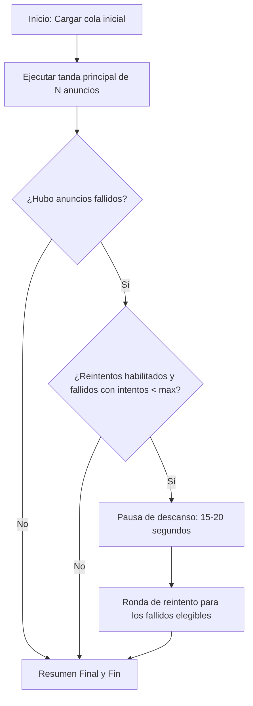

# Plan 8 — Sistema de Reintentos Controlados para Anuncios Fallidos en Publicación

**Fuente:** [publicar_2-no_reintenta_automatico-no_puedes_reintentar_fallidos.md](file:///home/camiloueransim/maybel-ventas/renovar-anuncios/ideas-versiones/v1.1.0/bugs/publicar/publicar_2-no_reintenta_automatico-no_puedes_reintentar_fallidos.md)  
**Scripts a modificar:** EXCLUSIVAMENTE en `scripts-gemini/` (`publicar_v2.py`) — NO tocar `scripts-opus/`  
**Estado:** Completado ✅  

---

## 1. Diagnóstico y Causa Raíz

### 1.1. El Problema Reportado
Al publicar una tanda de 10 productos en una cuenta (ej. `fernandoantigravity12@gmail.com`), 6 se publican exitosamente y 4 fallan con el mensaje:
```text
⏳ Esperando confirmación...
❌ No se pudo confirmar la publicación
```

Al terminar la tanda:
- **No hay reintento automático al final:** Los 4 anuncios que fallaron se descartan de inmediato sin una segunda oportunidad.
- **Bloqueo permanente al volver a ejecutar el comando:** Si el usuario vuelve a correr el comando en consola:
  ```bash
  python3 scripts-gemini/publicar_v2.py --email fernandoantigravity12@gmail.com --descripciones-aleatorias
  ```
  El script responde:
  ```text
  ✅ No hay productos pendientes para fernandoantigravity12@gmail.com
  ```
  y termina sin intentar publicar los 4 que quedaron sin salir.

---

### 1.2. Causa Raíz Técnica

1. **Filtro excluyente en `obtener_pendientes()`**:
   En `publicar_v2.py`:
   ```python
   def obtener_pendientes(cuenta):
       """Devuelve solo las publicaciones pendientes."""
       return [p for p in cuenta.get("publicaciones", []) if p.get("estado") == "pendiente"]
   ```
2. **Marcado irreversible a `"fallido"`**:
   Cuando un anuncio no se confirma, se ejecuta:
   ```python
   cuenta = marcar_publicacion(cuenta, producto, "fallido", ...)
   ```
   Esto cambia `pub["estado"] = "fallido"` en el archivo `estado/cuentas/<email>.json`.
3. **Ausencia de estado intermedio y contador de intentos**:
   El modelo actual solo contempla dos estados finales (`"publicado"` o `"fallido"`). No existe un contador (`"intentos": N`) ni un límite máximo, por lo que una publicación fallida queda huérfana en el JSON.
4. **Falsos fallos de confirmación en Revolico**:
   En `publicar_anuncio()`, el script hace clic en submit y espera 25 segundos a que la URL cambie. Si Revolico sufre una demora temporal de red, si requiere un segundo clic o si muestra una advertencia menor, se cumple el timeout y se marca como fallido para siempre.

---

## 2. Requerimientos del Usuario

1. **Poder reintentar al ejecutar nuevamente el comando:**
   Si el usuario vuelve a correr el comando, el script debe ser capaz de procesar los anuncios que quedaron en estado fallido sin decir que "no queda nada".
2. **Reintento automático al final de la misma sesión:**
   Si en una tanda de 10 anuncios fallan 4, el script debe hacer una pausa de enfriamiento y reintentar automáticamente esos 4 antes de cerrar la sesión.
3. **Límite estricto de reintentos (Evitar bucles infinitos):**
   Debe existir un parámetro `--max-reintentos` (por defecto `1` reintento en la misma sesión, y configurable hasta `N`) y un contador persistido en el JSON (`"intentos": X`). Si un anuncio alcanza el límite máximo permitido, se marca como `"fallido_definitivo"` para no quedarse en un bucle infinito intentándolo eternamente.

---

## 3. Diseño de la Solución Técnica

### 3.1. Estructura de Datos en `estado/cuentas/<email>.json`
Añadiremos seguimiento de intentos y motivo de fallo en cada publicación:

```json
{
  "producto": "cama plegable",
  "titulo_usado": "cama plegable",
  "imagenes_usadas": ["variantes_.../foto_v002.jpg"],
  "descripcion_usada": "Texto...",
  "fecha_asignacion": "2026-10-15T22:20:12",
  "estado": "fallido",
  "intentos": 1,
  "ultimo_error": "Timeout esperando confirmación de URL",
  "fecha_ultimo_intento": "2026-10-15T22:23:10",
  "url_revolico": null
}
```

---

### 3.2. Selección de Productos a Publicar (`obtener_cola_publicacion`)

Sustituir `obtener_pendientes()` por una función más flexible:

```python
def obtener_cola_publicacion(cuenta, incluir_fallidos=False, max_intentos=2):
    """
    Obtiene la lista de publicaciones a procesar:
    1. Publicaciones con estado == 'pendiente' (intentos < max_intentos).
    2. Si incluir_fallidos es True (o si no hay pendientes pero sí fallidos recuperables),
       incluye publicaciones con estado == 'fallido' cuyo contador de intentos sea < max_intentos.
    """
    publicaciones = cuenta.get("publicaciones", [])
    pendientes = [p for p in publicaciones if p.get("estado") == "pendiente"]
    
    fallidos_recuperables = [
        p for p in publicaciones 
        if p.get("estado") == "fallido" and p.get("intentos", 1) < max_intentos
    ]
    
    if pendientes:
        if incluir_fallidos:
            return pendientes + fallidos_recuperables
        return pendientes
    
    # Si no hay pendientes puros, pero sí fallidos recuperables
    if fallidos_recuperables:
        return fallidos_recuperables
        
    return []
```

---

### 3.3. Argumentos CLI Nuevos en `publicar_v2.py`

| Argumento | Tipo | Default | Descripción |
|---|---|---|---|
| `--reintentar-fallidos` | flag booleano | `False` | Fuerza a incluir publicaciones en estado `fallido` que no hayan superado el límite. |
| `--max-reintentos` | int | `2` | Número máximo de intentos permitidos por anuncio antes de considerarlo fallido permanente. |
| `--sin-reintento-sesion`| flag booleano | `False` | Desactiva la ronda de reintento automático al final de la misma ejecución. |

---

### 3.4. Flujo de Ejecución con Reintento al Final de la Tanda



#### Reglas durante el reintento:
1. **Rotación de título fresca:** Como cada intento de publicación rota `producto.json`, el reintento usará el nuevo título de la cola para evitar que el fallo haya sido por coincidencia de título.
2. **Nueva descripción aleatoria:** Si se usa `--descripciones-aleatorias`, el reintento toma una nueva frase disponible del banco para asegurar máxima variación.
3. **Incremento del contador:** Cada intento suma `pub["intentos"] = pub.get("intentos", 0) + 1`. Si llega a `max_intentos` y sigue fallando, su estado pasa a `"fallido_definitivo"`.

---

### 3.5. Robustez en la Confirmación (`publicar_anuncio`)

Para evitar falsos fallos en `⏳ Esperando confirmación...`:
1. **Re-intento de clic:** Si tras 10 segundos la URL no ha cambiado de `/publish`, verificar si el botón `button[type="submit"]` sigue presente y no está disabled, y emitir un clic de refuerzo con `page.click('button[type="submit"]')`.
2. **Detección de errores en el DOM:**
   Antes de declarar fallo, buscar selectores típicos de error en Revolico:
   - `[role="alert"]`
   - `.text-red-500`, `.text-danger`, `.error-message`
   - Modales de advertencia.
   Si se detecta un mensaje, imprimirlo claramente:
   ```text
   ⚠️ Revolico mostró un error: "Ya existe un anuncio similar recientemente"
   ```
3. **Tolerancia de URL:**
   Verificar no solo si la URL cambió a `/item/12345/`, sino también si redirigió a `/manage` o si el formulario desapareció mostrando pantalla de éxito.

---

## 4. Plan de Implementación Paso a Paso

### Paso 1: Actualizar funciones de estado en `publicar_v2.py`
- Modificar `marcar_publicacion` para aceptar `intentos`, `ultimo_error` y actualizar la fecha.
- Implementar `obtener_cola_publicacion(cuenta, incluir_fallidos, max_intentos)`.

### Paso 2: Añadir opciones CLI en el parser
- `--reintentar-fallidos`
- `--max-reintentos` (default: 2)
- `--sin-reintento-sesion`

### Paso 3: Implementar la fase de Reintento al final de la tanda en `main()`
- Al finalizar el bucle `for pub in pendientes`:
  - Recolectar la lista `para_reintentar = [p for p in tanda if p.get("estado") == "fallido" and p.get("intentos", 1) < args.max_intentos]`.
  - Si hay elementos y no está activado `--sin-reintento-sesion`:
    - Mostrar aviso: `🔄 Iniciando ronda de reintento para X anuncios fallidos...`
    - Pausa humana de 15 segundos.
    - Ejecutar los reintentos actualizando el contador.

### Paso 4: Mejorar la confirmación y diagnóstico en `publicar_anuncio()`
- Añadir verificación de alertas en el DOM si no redirige en 10s.
- Segundo clic de soporte en el submit.

---

## 5. Verificación y Casos de Prueba

1. **Prueba 1: Detección inteligente de fallidos previos en consola**
   - Ejecutar en modo `--preview` sobre `fernandoantigravity12@gmail.com` (que tiene 4 fallidos del log).
   - Verificar que el script detecta los 4 fallidos y los muestra listos para ser reintentados en vez de decir "no hay productos pendientes".
2. **Prueba 2: Respeto del límite de reintentos (`--max-reintentos`)**
   - Verificar que una vez que un anuncio alcanza el límite configurado (ej: 2 intentos), ya no vuelve a entrar en la cola automática.
3. **Prueba 3: Reintento automático en la misma sesión**
   - Simular un fallo forzado o probar en vivo para constatar que al terminar la tanda corre la segunda pasada de reintento para los que fallaron.

---

> [!IMPORTANT]
> Este plan asegura que **ningún anuncio quede abandonado por una caída temporal de conexión o timeout**, permitiendo reintentos tanto automáticos al final de la tanda como manuales al reescribir el comando, con un **límite de seguridad estricto** que previene bucles infinitos.
